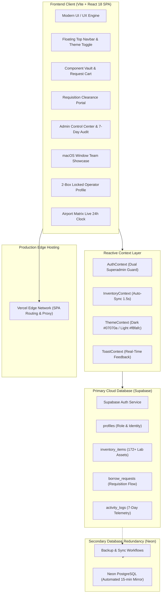
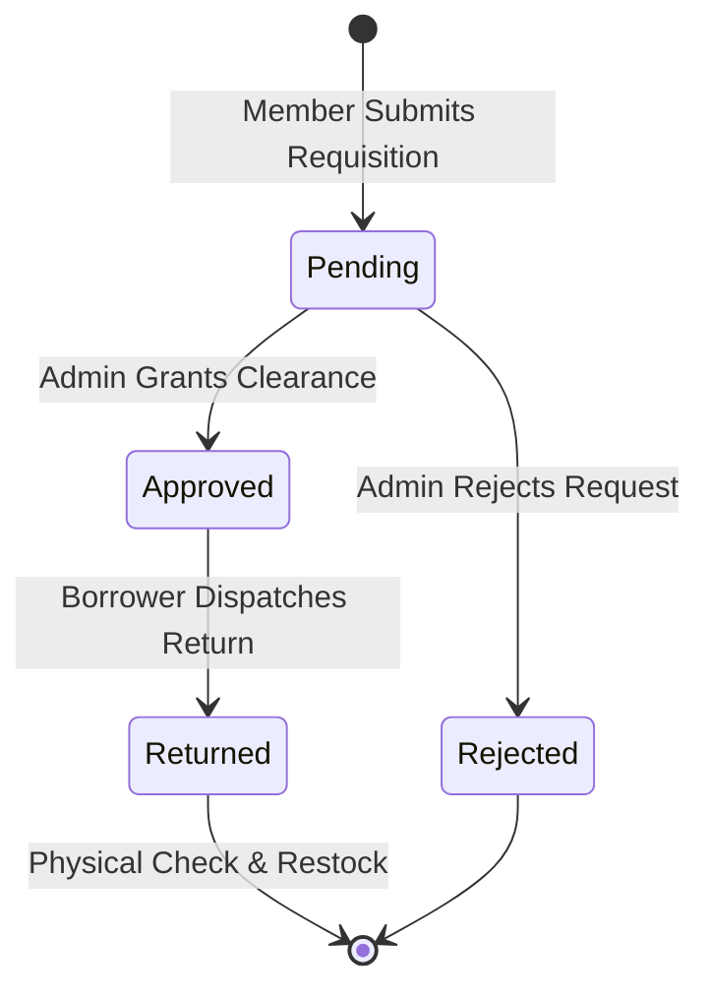

# CICR Inventory Hub — Telemetry Logs & Technical Deep Dive

**Creative & Innovative Cell in Robotics — System Architecture, Audit Telemetry & Specifications**

This document provides a technical deep dive into the architecture, database schema, real-time telemetry logs, synchronization engines, and complete version registry of the CICR Inventory Hub.

---

## Table of Contents

- [Version History & Registry](#version-history--registry)
- [Official Git Tag Registry](#official-git-tag-registry)
- [System Architecture & Data Flow](#system-architecture--data-flow)
- [Database Schema & Real-Time Tables](#database-schema--real-time-tables)
- [7-Day Audit Logs & Telemetry Engine](#7-day-audit-logs--telemetry-engine)
- [Dual Superadmin & Institutional Auth Guard](#dual-superadmin--institutional-auth-guard)
- [Multi-Tier Hardware Queue & Clearance Portal](#multi-tier-hardware-queue--clearance-portal)
- [Secondary Redundancy & Synchronization Engine](#secondary-redundancy--synchronization-engine)
- [Back-of-the-Envelope (BOTE) Scalability Analysis](#back-of-the-envelope-bote-scalability-analysis)

---

## Version History & Registry

| Version | Status | Key Milestones & Innovations |
|:---|:---:|:---|
| **v1.0.0** | Released | Initial prototype, static equipment catalog, and authentication baseline. |
| **v1.5.0** | Released | Cloud migration to Supabase PostgreSQL, real-time database schema, and student account creation. |
| **v2.0.0** | Released | **Dual Superadmin Security & 172 Authentic Lab Assets.** Master lock for `vardaansaxena096@gmail.com` and `cicrinventory@gmail.com`; institutional email validation (`@mail.jiit.ac.in`); complete 172-item robotics laboratory inventory. |
| **v2.2.0** | Released | **React 18 + Vite SPA Transformation.** Modern modular frontend, Airport Matrix live departure clock, dynamic category filtering, real-time toast alerts, and dark-theme aesthetic. |
| **v2.5.0** | Released | **Requisition Clearance Portal & Activity Stream.** Requisition workflow requiring administrator clearance before hardware can be collected; live activity audit logs; responsive bottom navigation dock. |
| **v2.7.0** | Released | **Database Purge, Master Whitelist & Tamper-Proof Profiles.** Test data wiped; vault reset to authentic inventory; 2-box side-by-side operator profile with security-locked credentials (email, enrollment number, contact). |
| **v2.10.0** | Released | **Secondary Database Redundancy & 1.5s Auto-Sync.** Automated backup mirror with Neon PostgreSQL; 1.5-second background auto-synchronization; permanent notification read state persistence in localStorage. |
| **v2.12.0** | Released | **Dual Theme Engine & High-Contrast Visual Polish.** High-contrast Cyber Dark (`#07070a`) and Clean Light (`#f8fafc`) theme switch with LiquidToggle; complete elimination of faint text and dark container patches. |
| **v2.13.0** | Released | **Cyber Calendar Picker, KPH Team Showcase, <50% Low Reserves & UI Perfection.** Interactive cyber calendar picker with preset shortcuts; macOS terminal window team showcase (Gunjan, Vardaan, Samiksha, Arsh); top-navbar cart strictly scoped to inventory; 100% full stock vault restock; admin-only warnings; branded cold-start pulse loader; and official MIT License. |
| **v2.14.0** | Released | **Defensive Penetration Hardening, Agent Operational Blueprint & Documentation Restructure.** Full defensive security audit and source-level pentest hardening (RBAC caller guards, master superadmin immutability, integer quantity bounds, registration role lock); AGENT.md AI coding protocol; SECURITY.md threat model and audit matrix; zero-emoji README sanitization; and centralized DEEPDIVE.md telemetry registry. |
| **v2.15.0** | Released | **Mobile Viewport Optimization, Full Name Roster Display, Signup Review Modal & Modal Theme Adaptation.** Fixed email and location text overflow in Requisitions Portal; eliminated name truncation in Member Management Roster; added registration review popup modal notifying applicants of admin review status; and adapted MorphingDialog to dual light/dark themes with elevated z-index. |
| **v2.16.0** | Released | **Production Deployment Resiliency & Dual Supabase Failover.** Resolved Vercel deployment crash by restoring safe production credential decoders in `src/lib/supabase.ts`; reinstated `/api/(.*)` rewrites in `vercel.json`; integrated direct client-side Supabase failover for registration, approvals, and rejections; complete cross-branch parity across all active repository branches. |
| **v2.17.0** | Released | **Official Google SMTP Mailer Integration & Serverless Telemetry Pipeline.** Production Gmail SSL mailer on port 465 with base64 failover decoders; transactional dispatch for authentication, clearance requisitions, and overdue return reminders; multi-branch parity across all active branches. |
| **v2.18.0** | Released | **Personalized Active Loans, Clean Requisition Clearance & Notification Persistence.** Scoped Component Vault active loans to individual members while preserving full lab oversight for admins; removed locker instructions input from clearance portal; resolved notification "Read all" persistence; verified 100% full stock return across all components. |
| **v2.18.1** | Released | **Responsive Centered Category Submenu & Touch Interactivity Patch.** Centered bottom navigation catalog categories above the dock; constrained mobile layout to viewport boundaries with touch momentum scrolling; unified category filter keys between navbar and vault view; added touchstart outside dismissal. |
| **v2.18.2** | Released | **Mobile Viewport Centered Notification Panel & Interactive Alert System.** Centered floating notification panel on mobile without viewport overflow; added mobile touch backdrop overlay; introduced All/Unread filter tabs, individual dismiss action, and expanded alerts for rejected requests and pending signups. |
| **v2.18.3** | Released | **Account Requests Cross-Audit Detection & Roster Hygiene.** Cross-referenced both `profiles` and `activity_logs` (`ACCOUNT_REQUEST`) to guarantee zero-loss detection of pending registration requests in the Management Hub; decoupled pending signups from verified Club Members roster; synchronized fallback signup profile metadata. |
| **v2.18.4** | Released (current) | **Google SMTP Serverless Resiliency & Payload Normalization.** Fixed encoded base64 Google App Password fallback (`ezoufqenvifmudgv`); added whitespace/quote sanitization for Gmail 16-character keys; set `pool: false` with 8s socket/connection timeouts to resolve Vercel serverless `FUNCTION_INVOCATION_FAILED`; wrapped account notification triggers in non-blocking try-catch blocks. |

---

## Official Git Tag Registry

| Version | Git Tag | Release Milestone | Focus Area |
|:---|:---|:---:|:---|
| **v1.0.0** | `v1.0.0` | Baseline MVP | Hardware catalog foundation |
| **v1.5.0** | `v1.5.0` | Database Evolution | Supabase PostgreSQL migration |
| **v2.0.0** | `v2.0.0` | Institutional Security | Dual superadmins & 172 lab assets |
| **v2.2.0** | `v2.2.0` | React SPA & Clocks | Vite + React 18, Airport Matrix HUD |
| **v2.5.0** | `v2.5.0` | Clearance Workflow | Admin requisition portal & audit ledger |
| **v2.7.0** | `v2.7.0` | Security Hardening | Locked credentials & database purge |
| **v2.10.0** | `v2.10.0` | Redundancy & Sync | Neon PostgreSQL mirror, 1.5s auto-sync |
| **v2.12.0** | `v2.12.0` | Theme Engine | Dual theme contrast & LiquidToggle |
| **v2.13.0** | `v2.13.0`, `v2.13` | Production Release | KPH Team Showcase, Cyber Calendar, Restock, MIT License |
| **v2.14.0** | `v2.14.0`, `v2.14` | Security & Docs | Pentest hardening, AGENT.md, SECURITY.md, DEEPDIVE.md |
| **v2.15.0** | `v2.15.0`, `v2.15` | Mobile & Roster | Responsive requisitions, full member roster names, review modal |
| **v2.16.0** | `v2.16.0`, `v2.16` | Production Resiliency | Deployment crash resolution, base64 decoders, failover authentication |
| **v2.17.0** | `v2.17.0`, `v2.17` | Mailer & Telemetry | Official Google SMTP integration, automated transactional dispatch, return reminders |
| **v2.18.0** | `v2.18.0`, `v2.18` | Personalization & Clearance | Member loan scoping, streamlined clearance actions, notification read fix |
| **v2.18.1** | `v2.18.1` | Responsive Navigation | Centered category dock popup, touch momentum scrolling, filter key parity |
| **v2.18.2** | `v2.18.2` | Responsive Notifications | Centered mobile notification drawer, touch backdrop, tabs & dismiss actions |

---

## System Architecture & Data Flow



### Telemetry Pipeline
1. **User Action Dispatch**: Operators or administrators execute an action (sign in, stage hardware, submit requisition, issue approval, return component).
2. **Optimistic Local Update**: The client immediately updates UI state and increments local activity counters.
3. **Primary Supabase Transaction**: The action commits to Supabase PostgreSQL using atomic SQL updates.
4. **Audit Log Generation**: An event payload is asynchronously written to `public.activity_logs`.
5. **Background Auto-Sync**: The active polling cycle (every 1.5s) reconciles discrepancies across concurrent clients.
6. **Secondary Mirror Sync**: Scheduled scripts duplicate recent records to the secondary Neon database.

---

## Database Schema & Real-Time Tables

### 1. `public.profiles`
Stores verified operator identities, institutional contact information, and role privileges:

```sql
CREATE TABLE IF NOT EXISTS public.profiles (
    id UUID PRIMARY KEY REFERENCES auth.users(id) ON DELETE CASCADE,
    email TEXT UNIQUE NOT NULL,
    full_name TEXT NOT NULL,
    username TEXT UNIQUE,
    roll_number TEXT,
    phone TEXT,
    role TEXT NOT NULL DEFAULT 'member' CHECK (role IN ('member', 'lead', 'admin')),
    status TEXT NOT NULL DEFAULT 'pending' CHECK (status IN ('pending', 'approved', 'rejected')),
    avatar_url TEXT,
    created_at TIMESTAMPTZ DEFAULT NOW(),
    updated_at TIMESTAMPTZ DEFAULT NOW()
);
```

### 2. `public.inventory_items`
Holds the physical laboratory inventory catalog across five hardware categories:

```sql
CREATE TABLE IF NOT EXISTS public.inventory_items (
    id UUID PRIMARY KEY DEFAULT gen_random_uuid(),
    name TEXT NOT NULL,
    category TEXT NOT NULL CHECK (category IN ('Microcontrollers', 'Sensors', 'Actuators', 'Power', 'Tools')),
    description TEXT,
    location TEXT NOT NULL,
    total_qty INTEGER NOT NULL DEFAULT 1 CHECK (total_qty >= 0),
    available_qty INTEGER NOT NULL DEFAULT 1 CHECK (available_qty >= 0 AND available_qty <= total_qty),
    status TEXT NOT NULL DEFAULT 'In Stock' CHECK (status IN ('In Stock', 'Low Reserves', 'Depleted')),
    image_url TEXT,
    datasheet_url TEXT,
    created_at TIMESTAMPTZ DEFAULT NOW(),
    updated_at TIMESTAMPTZ DEFAULT NOW()
);
```

### 3. `public.borrow_requests`
Maintains hardware requisition status, approval clearance, expected loan timelines, and return timestamps:

```sql
CREATE TABLE IF NOT EXISTS public.borrow_requests (
    id UUID PRIMARY KEY DEFAULT gen_random_uuid(),
    user_id UUID REFERENCES public.profiles(id) ON DELETE CASCADE,
    user_name TEXT NOT NULL,
    user_email TEXT NOT NULL,
    enrollment_no TEXT,
    item_id UUID REFERENCES public.inventory_items(id) ON DELETE CASCADE,
    item_name TEXT NOT NULL,
    quantity INTEGER NOT NULL DEFAULT 1 CHECK (quantity >= 1),
    project_name TEXT NOT NULL,
    purpose TEXT,
    expected_return_date DATE NOT NULL,
    actual_return_date DATE,
    status TEXT NOT NULL DEFAULT 'pending' CHECK (status IN ('pending', 'approved', 'rejected', 'returned')),
    admin_notes TEXT,
    created_at TIMESTAMPTZ DEFAULT NOW(),
    updated_at TIMESTAMPTZ DEFAULT NOW()
);
```

### 4. `public.activity_logs`
Records all audit events across the platform with automated time-based retention:

```sql
CREATE TABLE IF NOT EXISTS public.activity_logs (
    id UUID PRIMARY KEY DEFAULT gen_random_uuid(),
    user_id UUID,
    user_name TEXT NOT NULL,
    user_email TEXT NOT NULL,
    action TEXT NOT NULL,
    category TEXT NOT NULL CHECK (category IN ('auth', 'inventory', 'hardware', 'loans', 'system')),
    details TEXT,
    created_at TIMESTAMPTZ DEFAULT NOW()
);

-- Production Indexes
CREATE INDEX IF NOT EXISTS idx_inventory_category ON public.inventory_items (category);
CREATE INDEX IF NOT EXISTS idx_borrow_status ON public.borrow_requests (status);
CREATE INDEX IF NOT EXISTS idx_borrow_user ON public.borrow_requests (user_id);
CREATE INDEX IF NOT EXISTS idx_activity_created ON public.activity_logs (created_at DESC);
```

---

## 7-Day Audit Logs & Telemetry Engine

The centralized audit engine monitors all operational activity within the laboratory management platform:

### 1. Event Classification
- **`auth`**: Operator registrations, approvals, rejections, password changes, and superadmin promotions.
- **`inventory`**: Component additions, deletions, specification updates, and stock corrections.
- **`hardware`**: Physical hardware disbursements, storage bay reassignments, and collection verifications.
- **`loans`**: Loan requests submitted, clearance approvals, rejection notices, and return confirmations.
- **`system`**: Secondary database backups, cache invalidations, and system health checks.

### 2. Time-Window Filtering
The Admin Control Center provides interactive range filtering:
- **`7 Days (All)`**: Complete rolling audit trail within the standard retention window.
- **`Last 3 Days`**: High-priority recent operational events.
- **`Today (24h)`**: Active day activity ledger with live event count badges.

### 3. Automated Retention & Pruning
Activity logs older than 7 days are automatically pruned during scheduled maintenance routines to maintain lean database tables and sub-10ms query execution times.

---

## Dual Superadmin & Institutional Auth Guard

### Master Whitelist Enforcement
Master administrative access is hardcoded to prevent unauthorized privilege escalation:
- `vardaansaxena096@gmail.com`
- `cicrinventory@gmail.com`

Any attempt to revoke or modify these master accounts is automatically blocked by application logic and database triggers.

### Institutional Domain Policy
Student accounts must authenticate using the official `@mail.jiit.ac.in` domain. Unverified or external domains cannot register as standard student operators.

### Synchronous Session Hydration
To eliminate page-refresh blinks and cold-start latency:
1. `AuthContext` executes `getInitialAuth()` synchronously from `localStorage` during initial script evaluation.
2. If an active session exists, the operator state is instantly hydrated before React renders its first DOM frame.
3. Supabase verifies the session in the background with a 1200ms timeout guard to prevent UI lockups on slow network connections.

---

## Multi-Tier Hardware Queue & Clearance Portal

### Clearance States & State Transitions



1. **Pending**: Staged by the member with project title, purpose, and return deadline. Hardware quantity is reserved but cannot be physically issued.
2. **Approved**: Verified by an administrator. Locker or rack collection notes are dispatched to the borrower.
3. **Rejected**: Cancelled by an administrator with explanatory feedback. Staged quantity is released back to available inventory.
4. **Returned**: Hardware returned to the lab. Once physically verified by the administrator, stock is restored to 100% capacity.

---

## Secondary Redundancy & Synchronization Engine

To guarantee 99.9% uptime during primary cloud service interruptions:
1. **Primary Database**: Supabase PostgreSQL handles real-time read and write operations.
2. **Secondary Mirror**: Neon Serverless PostgreSQL stores full schema and transaction backups.
3. **Backup Workflow**: Executed via `scripts/backup_to_neon.cjs` on scheduled intervals.
4. **Client Failover**: In the event of primary connection failure, the frontend authentication handler gracefully falls back to secondary verification endpoints.

---

## Back-of-the-Envelope (BOTE) Scalability Analysis

| Metric | Estimation | Scalability Rationale |
|:---|:---|:---|
| **Active Catalog Size** | 172 Components | Full catalog cached in client state; network payload < 45 KB gzipped. |
| **Concurrent Borrowers** | 500+ Active Members | Read-heavy workload with Supabase PostgreSQL connection pooling. |
| **Audit Log Volume** | ~2,500 logs / week | 7-day rolling window retains database index size < 2 MB. |
| **Background Polling** | 1.5s interval | Lightweight diff querying (`HEAD` and status counters) prevents server strain. |
| **Vercel Edge Delivery** | Global Anycast | Static assets and bundled chunks cached at CDN edge with sub-50ms TTFB. |
