# CICR Inventory Hub — Security Assessment & Penetration Test Report

**Creative & Innovative Cell in Robotics — Security Architecture, Threat Model & Vulnerability Audit**

This document details the defensive security assessment, threat modeling, penetration test findings, and architectural hardening implemented across the CICR Inventory Hub.

---

## Executive Summary

A comprehensive source code security assessment and penetration audit was conducted on October 31, 2026, evaluating the full-stack architecture of the CICR Inventory Hub across authentication, authorization, inventory mutation integrity, data concurrency, and dependency safety.

### Overall Security Posture
- **Authentication**: Hardened with institutional domain validation (`@mail.jiit.ac.in`), synchronous session hydration, and an admin verification gate.
- **Access Control (RBAC)**: Master superadmin whitelist locked to `vardaansaxena096@gmail.com` and `cicrinventory@gmail.com`. Server-level and client-level guards block unauthorized role promotion.
- **Input Validation**: Requisition quantities strictly validated as positive integers ($\ge 1$). Parameterized PostgREST queries prevent SQL injection.
- **Resilience**: Session race timeouts (1200ms) and React ErrorBoundaries prevent client lockups and denial-of-service conditions.

---

## Threat Model & Attack Surface Analysis

```mermaid
flowchart LR
    Attacker["Threat Actor"]
    Browser["Client Browser / DevTools"]
    AuthGate["Institutional Auth Guard"]
    StateLayer["Reactive State & Guards"]
    Supabase["Supabase Cloud PostgreSQL"]
    Neon["Neon Secondary Mirror"]

    Attacker -->|Inspect / Tamper| Browser
    Browser -->|API Calls| AuthGate
    AuthGate -->|Role Verification| StateLayer
    StateLayer -->|Parameterized SQL| Supabase
    Supabase -.->|Automated Sync| Neon
```



### Potential Attack Vectors Audited
1. **Privilege Escalation**: Attempting to register with `role: 'admin'` or modify profile roles.
2. **Requisition Tampering**: Attempting to self-approve hardware requisitions or modify item stock.
3. **Integer Arithmetic Abuse**: Supplying negative or fractional quantities to distort inventory calculations.
4. **Account Takeover / Bypassing Clearance**: Attempting to bypass the pending member approval queue.
5. **Denial of Service (Client)**: Forcing cold-start timeouts or crashing React component trees.

---

## Vulnerability Audit & Remediation Matrix

### SEC-01: Client-Side Role Escalation via Registration Payload
- **Severity**: High
- **Vulnerability**: The `signUp()` function in `AuthContext` previously accepted a generic `role` parameter without validating whether the registering email was an authorized superadmin. A malicious user could submit `{ role: 'admin' }` to claim administrative privileges.
- **Remediation**: Implemented strict role enforcement in `signUp()`. The assigned role is hard-locked to `'member'` and status is hard-locked to `'pending'` unless the registering email strictly matches the master superadmin whitelist (`vardaansaxena096@gmail.com` or `cicrinventory@gmail.com`).
- **Status**: **RESOLVED**

### SEC-02: Unauthenticated Account Approval & Rejection Calls
- **Severity**: High
- **Vulnerability**: `approveUserAccount()` and `rejectUserAccount()` lacked an explicit caller privilege check before executing profile mutations via the admin client. An unprivileged authenticated user could theoretically invoke these methods from browser developer tools.
- **Remediation**: Added explicit administrative identity verification at the entry of both functions. If the caller does not hold an authorized `admin` role or match the master whitelist, the request is immediately rejected with an `Unauthorized` error.
- **Status**: **RESOLVED**

### SEC-03: Self-Approval of Hardware Requisitions
- **Severity**: High
- **Vulnerability**: In `InventoryContext`, `updateBorrowStatus()` allowed transitioning request status to `'approved'` or `'rejected'` without validating caller authorization.
- **Remediation**: Added administrative clearance checks within `updateBorrowStatus()`. Status transitions to `'approved'` and `'rejected'` strictly require `admin` or `lead` credentials. Regular members are restricted solely to dispatching `'returned'` status updates for their own issued hardware.
- **Status**: **RESOLVED**

### SEC-04: Negative and Fractional Quantity Injection in Loans
- **Severity**: Medium
- **Vulnerability**: `submitBorrowRequest()` did not validate that `data.quantity` was a positive integer. A user submitting a negative quantity (e.g. `-10`) could create anomalous records and artificially inflate stock upon return reconciliation.
- **Remediation**: Added strict integer and boundary validation:
  ```typescript
  if (!data.quantity || data.quantity < 1 || !Number.isInteger(data.quantity)) {
    return { success: false, error: 'Invalid quantity: Must be a positive integer.' };
  }
  ```
- **Status**: **RESOLVED**

### SEC-05: Master Superadmin Demotion Prevention
- **Severity**: High
- **Vulnerability**: `handlePromoteRole()` did not prevent an administrator from accidentally or maliciously demoting the master superadmins (`vardaansaxena096@gmail.com` and `cicrinventory@gmail.com`).
- **Remediation**: Added an explicit immutability guard in `UserDashboard.tsx`. Master superadmin roles cannot be modified or demoted by any user.
- **Status**: **RESOLVED**

### SEC-06: Client Cold-Start Hangs & Session Denial of Service
- **Severity**: Medium
- **Vulnerability**: On slow or unreliable network connections, `supabase.auth.getSession()` could hang indefinitely, leaving users on a blank or unresponsive loading state.
- **Remediation**: Introduced a 1200ms `Promise.race` timeout on session initialization in `AuthContext` alongside a root-level `ErrorBoundary` in `App.tsx` that provides instant one-click session recovery.
- **Status**: **RESOLVED**

### SEC-07: SQL Injection Vulnerability Analysis
- **Severity**: Informational
- **Assessment**: All database communications utilize Supabase's PostgREST client (`supabase.from(...)`), which issues parameterized HTTP queries over SSL. User-supplied inputs are never interpolated directly into raw SQL strings.
- **Status**: **SECURE**

### SEC-08: Cross-Site Scripting (XSS) Analysis
- **Severity**: Informational
- **Assessment**: React's Virtual DOM automatically encodes all string interpolations before rendering. A complete audit confirmed zero usages of `dangerouslySetInnerHTML` across all components.
- **Status**: **SECURE**

### SEC-09: Dependency Security Scan
- **Severity**: Low
- **Assessment**: Run via `npm audit`. Identifies transitive advisories in dev dependencies (primarily `@vercel/node`). The production client bundle does not include backend node runtime dependencies.
- **Remediation**: Scheduled removal of legacy devDependencies and pinning of production dependencies.
- **Status**: **MITIGATED**

---

## Defensive Security Best Practices

1. **Strict Transport Security (HSTS)**: All production communication is enforced over HTTPS via Vercel's edge network.
2. **Row-Level Security (RLS)**: PostgreSQL tables are configured with RLS policies to restrict unauthorized row reading and modification.
3. **Session Token Storage**: Auth tokens are handled through Supabase Auth's encrypted local session storage with automatic refresh rotation.
4. **Audit Logging**: Sensitive actions (role changes, account approvals, hardware disbursements, deletions) are recorded in `public.activity_logs` with timestamps and operator monikers.

---

## Reporting a Security Vulnerability

If you discover a potential security vulnerability within the CICR Inventory Hub, please report it directly to the master superadmin:

- **Security Contact**: `vardaansaxena096@gmail.com`
- **Alternative Contact**: `cicrinventory@gmail.com`

Please include a detailed description of the vulnerability, steps to reproduce, and any relevant logs. We request that you adhere to responsible disclosure principles.
